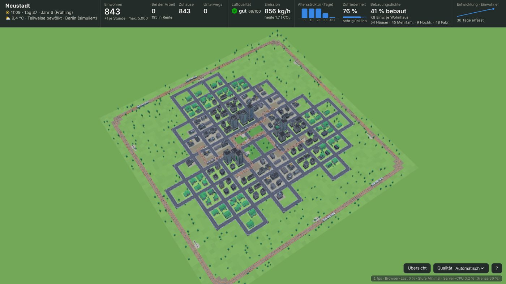
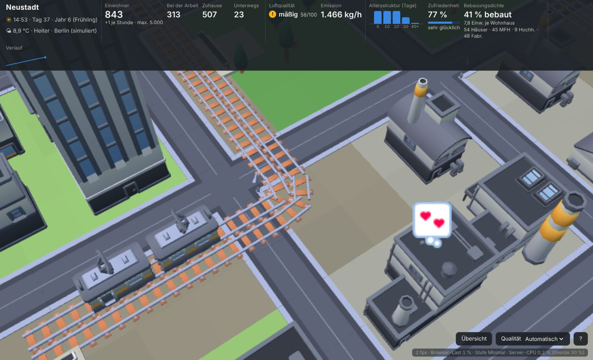
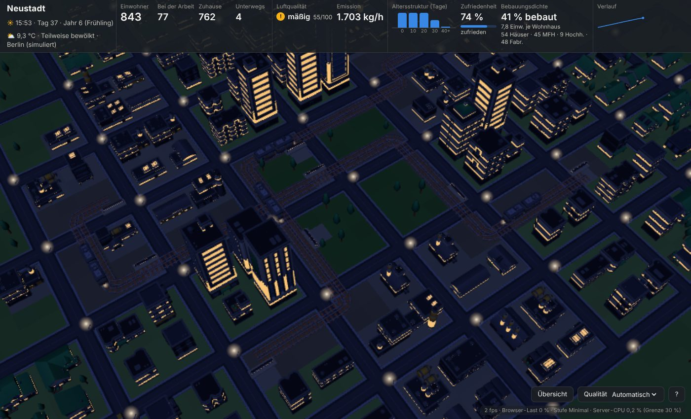
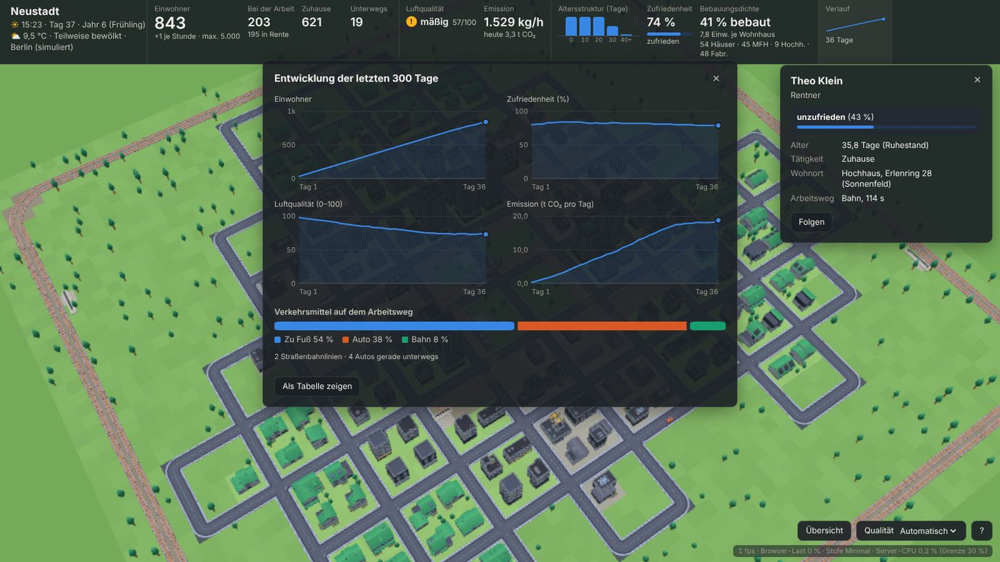

# CitySimulation

Eine dauerhaft laufende Stadtsimulation mit den Kenney-Assets. Sie läuft in einem
Docker-Container auf einem Raspberry Pi 4 (oder schneller) und wird im Browser angezeigt.
Aus einem kleinen Dorf mit Einfamilienhäusern wird mit der Zeit eine Stadt mit
Mehrfamilienhäusern, Hochhäusern, Industrie, Ringbahn und Straßenbahnen.



| Nahansicht mit Gedankenblasen | Nacht | Verlauf und Infofenster |
|---|---|---|
|  |  |  |

## Schnellstart auf dem Raspberry Pi 4

Voraussetzung: 64-Bit-Raspberry-Pi-OS mit Docker und dem Compose-Plugin
(`curl -fsSL https://get.docker.com | sh`).

```bash
git clone https://github.com/Codexzier/CitySimulation.git
cd CitySimulation
git checkout FirstCitySimulationState
nano docker-compose.yml        # ORT auf den eigenen Wohnort setzen (für das echte Wetter)
docker compose up -d --build
```

Danach im Browser öffnen: `http://<IP-des-Raspberry-Pi>:8080`

Der Spielstand liegt in `./data/stadt.json.gz` und wird alle 5 Minuten sowie beim
Stoppen (`docker compose down`) gespeichert. Nach einem Neustart läuft die Stadt dort
weiter, wo sie aufgehört hat.

## Was die Simulation macht

**Ansicht und Steuerung**
- Startansicht: die ganze Stadt aus der Vogelperspektive. Wird das Leistungsbudget
  (Standard 30 %) im Browser überschritten, senkt die Ansicht zuerst Bildrate und
  Detailstufe und zeigt notfalls einen Ausschnitt statt der ganzen Stadt.
- Mausrad: Zoom genau zu der Stelle, auf die der Mauszeiger zeigt.
- Linke Maustaste ziehen: verschieben · rechte Maustaste (oder Shift) ziehen: drehen ·
  Tasten: Pfeile/WASD, Q/E, +/−, Esc. Touch: ziehen und mit zwei Fingern zoomen/drehen.
- Klick auf ein **Wohnhaus**: Einwohner, Berufstätige, Glück, Bewohnerliste.
  Klick auf eine **Fabrik**: Arbeiter, Anwesende, Emission, Belegschaft.
  Klick auf eine **Person** oder ein **Auto**: Name, Alter, Beruf, Arbeitgeber, Wohnort,
  Glückszustand, aktueller Gedanke, Arbeitsweg – mit „Folgen“-Knopf.
  Klick auf eine **Bahn**: Linie, Fahrgäste. Klick auf einen **Bahnsteig**: Linien, Wartende.

**Infoleiste oben**
- Anzahl Einwohner, bei der Arbeit, zuhause, unterwegs
- Luftqualität (Index 0–100 mit Ampel-Symbol) und Emission (kg CO₂/h, Tagessumme)
- Gesellschaft: Altersstruktur, Zufriedenheit, Bebauungsdichte
- Verlauf: Klick öffnet die Entwicklung der letzten 300 Tage (Einwohner, Zufriedenheit,
  Luftqualität, Emission, Verkehrsmittel; auch als Tabelle)

**Wachstum**
- Start als Dorf mit einfachen Häusern (City Kit Suburban), pro Stunde kommt ein Einwohner dazu.
- Einwohner leben 30 bis 50 Tage.
- Ein Haus hat Platz für bis zu 4 Personen. Ab 5 Einwohnern wird es zum größeren Haus
  (City Kit Commercial), ab 11 Einwohnern zum Hochhaus (maximal 20 Einwohner).
- Die Einwohner werden möglichst gleichmäßig verteilt: zuerst freie Plätze, dann neue
  Häuser am Ortsrand, sonst wird in der Ortsmitte aufgestockt. So entsteht ein Zentrum
  mit Hochhäusern und ein Rand mit Einfamilienhäusern.
- Drei Wohnviertel (Lindenhof, Sonnenfeld, Rosengarten) und drei Industrieviertel
  (Eisenwerk, Chemiepark, Logistikpark) um einen Park in der Mitte. Fabriken entstehen,
  wenn Arbeitsplätze fehlen; jede Fabrik hat eine Branche mit passenden Berufen.

**Verkehr**
- Wer höchstens 4 Häuserblocks von der Arbeit entfernt wohnt, geht zu Fuß.
- Sonst Auto oder Bahn – je nachdem, was schneller ist und wie umweltbewusst die Person ist.
- Eine Ringbahn (train-electric-square) fährt in beiden Richtungen um den Ort.
- Pendeln viele Einwohner mit dem Auto zwischen einem Wohn- und einem Industrieviertel,
  wird eine **ideale Straßenbahnstrecke** (train-tram-classic) gebaut. Stehen Häuser im
  Weg, werden sie abgerissen; die Bewohner ziehen in andere Häuser und Hochhäuser um.
- Staus machen Autofahrer wütend, lange Arbeitswege unzufrieden.

**Gedanken (Emotes)**
Über Figuren und Gebäuden erscheinen Gedankenblasen: Verliebt, Enttäuscht, Singen, Freuen,
Böse, Schlafend, Schwitzend, Sorglos (Dollar), Entsetzt, Fragend, Abweisend, Benommen
(außerdem Liebeskummer). Sie hängen von Zufriedenheit, Arbeit, Partner, Wetter,
Luftqualität, Stau und Umzügen ab.

**Wetter, Tag und Jahr**
- Das Wetter folgt dem echten Wetter am eingestellten Ort (Open-Meteo, ohne API-Schlüssel):
  Regen, Schnee, Nebel, Bewölkung, Temperatur und Wind (Wind und Regen reinigen die Luft).
  Ohne Internet wird ein plausibles Wetter simuliert.
- Tag und Nacht wechseln alle 3 Stunden (3 h Tag, 3 h Nacht). Nachts leuchten Fenster,
  Laternen und Scheinwerfer.
- Alle 7 Tage beginnt ein neues Jahr (Frühling, Sommer, Herbst, Winter).

### Zeitmodell

Alle Angaben laufen in echter Zeit: „pro Stunde“, „Tage“ und „Jahr“ sind echte Stunden
und Tage. Nur der Tag-Nacht-Wechsel ist schneller (alle 3 Stunden), damit man ihn erlebt;
die Einwohner richten ihren Tagesablauf (Arbeit, Feierabend, Park, Schlafen) danach.
Bei 1 neuen Einwohner pro Stunde und 30–50 Tagen Lebensdauer pendelt sich die Stadt nach
etwa 6–7 Wochen bei rund 950 Einwohnern ein. Mit `ZEITRAFFER` läuft alles gleichmäßig schneller.

## Leistung (30 % des Raspberry Pi)

- **Docker:** `cpus: "1.2"` in `docker-compose.yml` begrenzt den Container hart auf
  30 % der 4 Kerne. Für mehr Leistung z. B. `"2.0"` (50 %) eintragen.
- **Simulation:** Der Server misst seine CPU-Zeit. Nähert sie sich `CPU_LIMIT_PROZENT`,
  drosselt er sich und stoppt den Zuzug. Daraus ergibt sich die maximal mögliche
  Stadtgröße („max. … Einwohner“ in der Infoleiste). Zusätzlich gilt `MAX_EINWOHNER`.
  Die Simulation selbst ist sehr sparsam (unter 1 % CPU bei ~1000 Einwohnern).
- **Browser:** Läuft der Browser auf dem Pi, begrenzt der Leistungswächter die
  Darstellung auf `CLIENT_LIMIT_PROZENT` (Bildrate, Auflösung, Schatten, Details).
  Die Stufe lässt sich unten rechts auch fest einstellen.

## Einstellungen (`docker-compose.yml`)

| Variable | Standard | Bedeutung |
|---|---|---|
| `ORT` | `Berlin` | eigener Ort für das echte Wetter |
| `BREITENGRAD`, `LAENGENGRAD` | – | genaue Koordinaten statt Ortsname |
| `TZ` | `Europe/Berlin` | Zeitzone (für die Exportzeit) |
| `STADT_NAME` | `Neustadt` | Name der Stadt |
| `STADT_BLOECKE` | `10` | Kartengröße in Blöcken je Seite (6–16, nur bei neuer Stadt) |
| `START_EINWOHNER` | `8` | Einwohner bei der Gründung |
| `CPU_LIMIT_PROZENT` | `30` | Leistungsbudget der Simulation (Anteil des ganzen Rechners) |
| `CLIENT_LIMIT_PROZENT` | `30` | Leistungsbudget der Darstellung im Browser |
| `CLIENT_MAX_FPS` | `30` | höchste Bildrate im Browser |
| `MAX_EINWOHNER` | `5000` | feste Obergrenze |
| `TAG_NACHT_WECHSEL_STUNDEN` | `3` | Dauer von Tag bzw. Nacht |
| `EINWOHNER_PRO_STUNDE` | `1` | Zuzug |
| `LEBENSDAUER_MIN_TAGE` / `_MAX_TAGE` | `30` / `50` | Lebensdauer der Einwohner |
| `JAHR_TAGE` | `7` | Länge eines Jahres |
| `HISTORIE_TAGE` | `300` | Länge des gespeicherten Verlaufs |
| `ZEITRAFFER` | `1` | beschleunigt die gesamte Simulation (z. B. `60` zum Ausprobieren) |
| `ZU_FUSS_BLOECKE` | `4` | bis zu dieser Entfernung wird zu Fuß gegangen |
| `TRAM_SCHWELLE` | `30` | Autopendler je Tag zwischen zwei Vierteln, ab denen eine Straßenbahn gebaut wird |
| `MAX_TRAM_LINIEN` | `6` | höchstens so viele Straßenbahnlinien |
| `EXPORT_ZEIT` | `00:05` | Uhrzeit für den täglichen Export |
| `SEED` | zufällig | feste Zufallszahl für eine reproduzierbare Karte |

Für Bildschirmfotos kann die Beleuchtung im Browser fest eingestellt werden:
`http://<pi>:8080/?tageszeit=12` (und `&wetter=regen|schnee|nebel|klar` für das Wetterbild).

## Täglicher Upload auf GitHub

Die Simulation schreibt jeden Tag um `EXPORT_ZEIT` die Ergebnisse nach `./data/export/`
und liefert sie auch über HTTP aus (`/api/export` erzeugt einen frischen Stand,
`/export/<datei>` lädt ihn). Das Skript `scripts/upload-ergebnisse.sh` holt die Dateien
ab und pusht sie in ein Ergebnis-Repository – die Webseite dafür entsteht separat.

1. Auf GitHub ein Repository anlegen, z. B. `CitySimulationResults`.
2. Auf dem Pi klonen (der Pi braucht Schreibrechte, z. B. per SSH-Schlüssel):
   ```bash
   git clone git@github.com:Codexzier/CitySimulationResults.git ~/CitySimulationResults
   ```
3. Cron-Job eintragen (`crontab -e`), täglich um 00:10 Uhr:
   ```
   10 0 * * * /home/pi/CitySimulation/scripts/upload-ergebnisse.sh >> /home/pi/stadt-upload.log 2>&1
   ```
   Pfade, Branch und Zielordner lassen sich mit Umgebungsvariablen anpassen
   (`SIM_URL`, `REPO_DIR`, `ZIEL_ORDNER` – Standard `data`, `BRANCH`, `GIT_NAME`, `GIT_MAIL`).
   Die Commits heißen z. B. `Stadt 2026-10-10 00:10 (Tag 37, 843 Einwohner)`.

### Exportierte Dateien

| Datei | Inhalt |
|---|---|
| `stadt_aktuell.json` | aktueller Stand: Einwohner, bei der Arbeit/zuhause/unterwegs, Arbeitslose, Rentner, Zufriedenheit, Luftqualität, Emission, Altersstruktur, Gebäude nach Art, Bebauung, Verkehrsmittel in %, Straßenbahnlinien, Wetter, Leistung |
| `stadt_historie.json` | ein Eintrag je Tag (bis zu 300): `tag`, `datum`, `jahr`, `einwohner`, `zufriedenheit`, `luft`, `emission_t`, `arbeitslose`, `zuzuege`, `tode`, `haeuser`, `mehrfamilienhaeuser`, `hochhaeuser`, `fabriken`, `bebauung`, `tramlinien`, `fuss`, `auto`, `bahn` |
| `stadt_ereignisse.json` | die letzten Ereignisse (Umbauten, neue Straßenbahnen mit Abrissen/Umzügen) |
| `stadt_karte.svg` | Grundriss der Stadt von oben (Straßen, Gebäude nach Art, Gleise, Haltestellen) |

## Entwicklung ohne Docker

```bash
npm install                 # three.js
npm run prepare-assets      # Modelle aus Assets/*.zip nach build/ entpacken
npm start                   # http://localhost:8080
ZEITRAFFER=120 npm start    # schneller Durchlauf (1 Tag ≈ 12 Minuten)
```

Benötigt Node.js 20 oder neuer. Der Server hat keine weiteren Abhängigkeiten.

## Aufbau

```
Assets/                 Kenney-Pakete (ZIP), werden beim Bauen entpackt
scripts/prepare-assets.mjs  wählt die benötigten Modelle aus und komprimiert sie
scripts/upload-ergebnisse.sh  täglicher Upload ins Ergebnis-Repository (Cron)
server/index.js         Webserver, Live-Datenstrom (Server-Sent Events), Takt, Leistungswächter, Speichern
server/sim/world.js     Karte: Blöcke, Grundstücke, Viertel, Straßenbau
server/sim/simulation.js  Einwohner, Tagesablauf, Wachstum, Umzüge, Emotionen, Umwelt, Statistik
server/sim/transit.js   Ringbahn, Straßenbahnplanung (A* mit Abrisskosten), Fahrpläne
server/sim/paths.js     Wegsuche für Fußgänger und Autos
server/sim/weather.js   Open-Meteo-Wetter mit Offline-Ersatz
server/export.js        täglicher JSON-/SVG-Export
client/                 Browser-Ansicht (three.js): Stadt, Figuren, Bahnen, Licht, Wetter, Oberfläche
```

Bewegungen werden nicht Bild für Bild übertragen: Der Server schickt nur Wegstrecken mit
Startzeit, Fahrpläne der Bahnen sind rein zeitbasiert. Der Browser berechnet daraus die
Positionen selbst – das hält die Last auf dem Pi und im Netzwerk sehr klein.

## Lizenzen

- Grafiken: [Kenney](https://kenney.nl) (CC0) – City Kit Suburban/Commercial/Industrial/Roads,
  Car Kit, Train Kit, Mini Characters, Emotes Pack
- [three.js](https://threejs.org) (MIT)
- Wetterdaten: [Open-Meteo](https://open-meteo.com) (CC BY 4.0)
